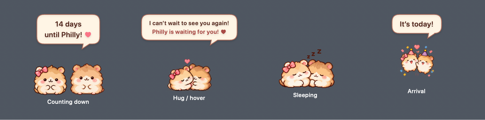

# Pixel-art implementation

All ten required sheets are installed in `PhillyHamsters/Assets/Assets.xcassets`, with 256×256 solo frames and 512×256 pair frames. Images have transparent backgrounds. The app icon and menu-bar pair use the final hug pose.

Artwork was generated with the built-in image_gen tool using `style-mockup.png` as the reference. The full prompt set is recorded in `artwork-manifest.json`. Generated strips were cropped and packed into equal-width frames; idle uses the open-eye blink frame to avoid an appearance change during blinking. Hearts and sleeping Zs are baked into the pair artwork.

The cream speech bubble follows the reference's explicit priority over the older text-only note in DESIGN_HANDOFF.md. Hover and excited reactions reveal the reunion message; the daily message remains available as the bubble tooltip. Sleeping hides the bubble. Countdown/date logic is unchanged.

Integration fixes allow solo excited frames to advance, show the closed-eye artwork during ambient blinking, and hold the final hug frame instead of looping it. No new animation states were introduced; optional eating, wave, back-view, and kiss states remain outside this change.

Validation: macOS build and 12 XCTest tests passed, including asset loading/frame geometry and excited/hug playback. The preview is rendered from the production SwiftUI views against a neutral dark background; the desktop panel remains transparent.
